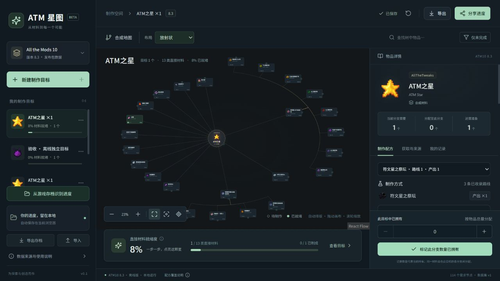

# ATM 星图 · ATM10 8.3 离线版

交互式 ATM 之星合成树与多目标进度追踪。Windows x64 免安装，完整解压后双击启动，无需安装 Node.js 或 Python，日常使用无需联网或 VPN。

**[在线使用 → ATM 星图](https://atm-star-map.cherrybell256.chatgpt.site)**

**[下载最新版 → Releases](https://github.com/KotoriEason/atm-star-map/releases/latest)** · **[直接下载 v1.0.1 Windows x64 ZIP（约 61.7 MB）](https://github.com/KotoriEason/atm-star-map/releases/download/v1.0.1/ATM-Star-Map-8.3-Offline-v1.0.1-win-x64.zip)**

请下载 Releases 中的 `ATM-Star-Map-…-win-x64.zip`。GitHub 自动生成的 “Source code” 压缩包是开发源码，不能直接双击运行。



## 三步开始

1. 下载离线 ZIP，并完整解压到普通文件夹。
2. 双击 **启动ATM星图.cmd**（也可用英文名 `Start.cmd`）。
3. 浏览器自动打开 `http://127.0.0.1:43183`。保持启动窗口打开，结束时按 Ctrl+C 或关闭该窗口。

目标平台：Windows 10/11 x64，现代 Edge 或 Chrome。本版实际验收环境为 Windows 11 普通用户；Windows 10 和全新虚拟机尚未实机验收。

## 功能

- 放射状、横向树、纵向树切换，逐层展开材料，查看制作路线、获取方式和模组来源。
- 按数量记录持有材料，自动计算当前目标的材料就绪度。
- 多个独立目标保存，布局与制作进度自动保存在当前浏览器。
- JSON 导出/导入与进度分享；本地解析 `level.dat` 或玩家 `.dat` 文件后预览并追加目标。
- 收录 ATM10 8.3 的 16,397 个物品身份、22,512 条配方/操作/标签路线，资源随离线包附带。

## 更新与进度迁移

**固定更新入口：[Releases 最新版](https://github.com/KotoriEason/atm-star-map/releases/latest)**。也可在 GitHub Watch → Custom 中只订阅 Releases 通知。

更新前先在旧版页面“导出存档”，关闭旧启动窗口；将新版解压到新文件夹并启动。使用同一浏览器和同一地址时，原进度仍可读取；换电脑或浏览器时导入备份 JSON。

在线版迁移：先在原网站导出 JSON，再在离线版点击“导入”。分享给朋友时发送完整离线 ZIP；分享个人进度时另发 JSON。`127.0.0.1` 指各自电脑，不是可供朋友访问你的电脑的网址。

进度存在浏览器 IndexedDB 中，不在解压文件夹里；请定期备份。离线版本身不自动下载升级。

## 说明与问题反馈

- [完整使用说明](offline/README.txt)
- [v1.0.1 验收记录](docs/offline-acceptance.md)
- [源码开发、数据生成与构建](docs/development.md)
- [维护者：发布后续版本](docs/releasing.md)
- [提交问题或建议](https://github.com/KotoriEason/atm-star-map/issues)

v1.0.1 ZIP SHA-256：

```text
aa5e98578f553fca94ba8ec37bf660545c5980e81a9983d7ccebfdb507ef3da7
```

配方来自固定版本发布资源的静态解析，动态/概率/条件配方、部分译名和特殊模型仍有已注明的边界；导入小型玩家文件不代表扫描整个世界或 AE/RS 网络。详见数据说明。

本项目与 ATMTeam、Minecraft 或相关模组作者无关联。物品名称、翻译、贴图和模型归各自作者所有，来源见 [资源说明](docs/item-resources.md)。前端依赖及 Node.js 许可证随离线包附带。本仓库未另外指定项目代码的开源许可证；公开可见不代表第三方资源版权发生变化。
